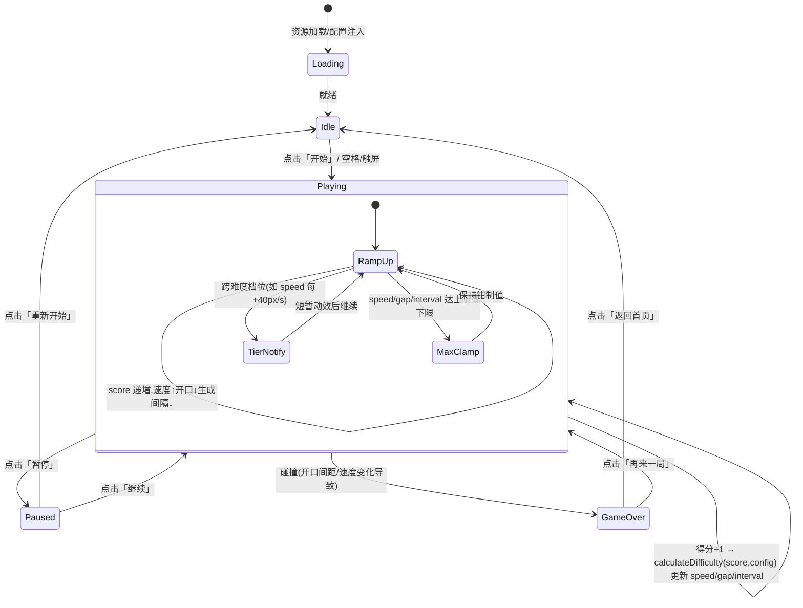

# UX 设计 — 实现随分数递增的难度曲线计算函数

> 所属需求：核心玩法：难度递增曲线

## 交互流程图


```

## 组件线框说明

核心页面为单屏游戏画布，由三层叠加组成：\n\n【1. HUD 顶栏（常驻，浮于画布之上）】\n- 左区：暂停按钮（icon: pause，44x44px 热区）\n- 中区：当前得分计数器（大号数字，得分变化时轻微缩放脉冲反馈）\n- 右区：本局最佳/历史最佳徽章（icon: trophy + 数字）\n\n【2. 游戏主区域（Canvas，中间层）】\n- 动态元素：小鸟（玩家）、管道对（上下管道，间距=gap）、地面滚动条\n- 难度反馈层（非交互）：当 speed 跨档位提升时，管道边缘短暂高亮脉冲（0.3s）提示「加速」；开口间距收窄时管道口轻微发光强调可通行通道\n- 顶部可选难度档位指示条：将 speed 映射为 1-5 档小圆点，当前档位点亮\n\n【3. 覆盖层（Overlay，最高层，按状态显隐）】\n- Idle 覆盖层：标题 logo、开始按钮（主 CTA）、操作说明文案、难度曲线预览（可选）\n- Pause 覆盖层：继续按钮、重新开始按钮、返回首页按钮\n- GameOver 覆盖层：结算面板（最终得分、最佳得分、奖牌图标）、再来一局按钮、返回首页按钮\n- Loading 覆盖层：加载进度条/转圈 + 文案「加载中…」\n- Error 覆盖层：配置加载失败提示 + 重试按钮（回退到内置默认常量表）

## 交互状态定义

【开始按钮（Start）】\n- normal：可点击，主 CTA 高亮\n- hover：亮度 +5%（仅桌面）\n- active/pressed：scale 0.95 + 亮度降低\n- disabled：opacity 0.45，cursor not-allowed（Loading 阶段）\n- loading：显示 spinner，禁止重复点击（首次进入时）\n- 无 empty/error 状态\n\n【暂停按钮（Pause）】\n- normal：可点击\n- hover：微变亮\n- active/pressed：scale 0.9\n- disabled：opacity 0.45（Idle/GameOver 阶段禁用）\n\n【继续按钮（Resume）】\n- normal/hover/active 同上\n- loading：无需（即时恢复）\n\n【重新开始 / 再来一局按钮（Restart）】\n- normal/hover/active/disabled 同上\n- loading：点击后 0.3s 过渡，防连点\n\n【返回首页按钮（Home）】\n- normal/hover/active 同上\n\n【重试按钮（Retry，仅 Error 态）】\n- normal/hover/active 同上\n\n【得分计数器（非交互）】\n- 状态：normal（持续显示）/ pulse（得分+1 时 0.15s 放大回弹）\n\n【难度档位指示条（非交互）】\n- 状态：tier1-5 点亮 / clamp（到达上限后末档常亮并加锁图标提示已达最大难度）

## 响应式/适配规则

断点：mobile < 768px / tablet 768-1024px / desktop > 1024px\n\n【mobile（< 768px，竖屏为主）】\n- 单列布局，画布全屏竖屏；HUD 顶栏高度 56px\n- 按钮热区 ≥ 44x44px，暂停按钮贴左上角（防误触），得分居中\n- 触屏交互，无 hover；点击即 active 反馈\n- 结算面板底部弹出式（bottom sheet），从下向上 + fade 200ms\n\n【tablet（768-1024px）】\n- 画布居中，两侧留白；HUD 顶栏高度 64px\n- 支持 hover 与 touch 双模式\n- 结算面板居中弹窗，fade 150ms\n\n【desktop（> 1024px）】\n- 画布居中，最大宽高约束（如 900x600 视口适配）；HUD 顶栏高度 64px\n- 完整 hover 反馈；支持空格=开始/暂停快捷键\n- 结算面板居中弹窗，从下向上 + fade 200ms\n\n通用：\n- 画布按等比缩放适配，难度参数（speed/gap/interval）基于游戏坐标，不随屏幕尺寸缩放失真\n- 所有弹窗出现 200ms、消失 150ms；Toast 停留 2s

## UI 资产清单（初稿）

- icon: play（开始按钮，24px，outline 风格）\n- icon: pause（暂停按钮，24px，outline 风格）\n- icon: restart（重新开始/再来一局按钮，24px，outline 风格）\n- icon: home（返回首页按钮，24px，outline 风格）\n- icon: trophy（最佳得分徽章，20px，filled 风格）\n- icon: medal-bronze/silver/gold/platinum（结算奖牌，32px，filled 风格）\n- icon: lock（难度档位达到上限时的锁定提示，16px，outline 风格）\n- illustration: empty-state（无历史最佳记录时结算面板占位，400x300）\n- illustration: tutorial-hint（Idle 层操作指引插画：点击/空格控制小鸟，400x300）\n- image: game-title-logo（首页标题 logo，300x120，透明背景 PNG）\n- image: background（游戏主场景背景，按画布尺寸 2x 导出，如 1800x1200）\n- image: ground-tile（可平铺地面贴图，宽 288px 无缝平铺）\n- image: pipe-sprite（上下管道精灵图，含可通行通道高亮帧，管道宽 80px）\n- image: bird-sprite（小鸟多帧动画序列图，单帧约 60x45，含待机/上冲/下坠帧）
