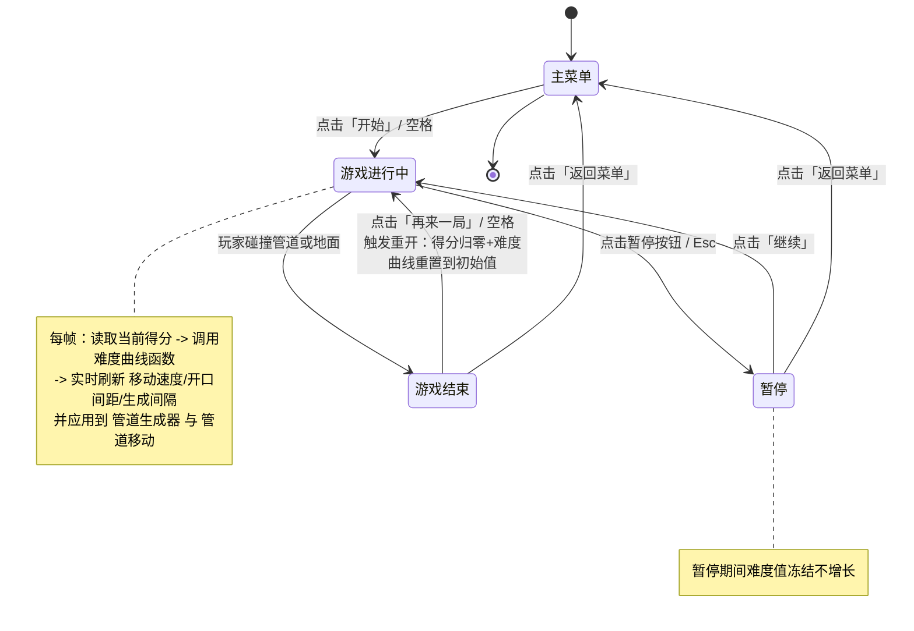

# UX 设计 — 集成难度曲线到游戏循环并实现重开重置

> 所属需求：核心玩法：难度递增曲线

## 交互流程图

## 组件线框说明

游戏画面分层结构（自上而下 4 层）

【第 1 层 背景层（静态）】
- 背景图：远景天空/城市/山丘
- 地面：底部可滚动地面条（装饰，随移动速度滚动）

【第 2 层 游戏层（Canvas 核心玩法区）】
- 玩家角色：小鸟（受重力/点击上浮）
- 管道组：成对的上管道 + 下管道，开口间距由难度曲线「开口间距」实时决定
- 生成器：按难度曲线「生成间隔」决定下一组管道生成时机
- 移动控制：所有已生成管道按难度曲线「移动速度」水平左移
- 得分判定区：管道之间的不可见通过线，玩家穿过 +1 分

【第 3 层 HUD 层（常驻信息）】
- 左上角：暂停按钮
- 顶部中央：当前得分（大字，随得分实时刷新）
- 顶部右上：（可选）本局最高分

【第 4 层 弹窗/面板层（覆盖层）】
- 主菜单面板：游戏标题、开始按钮
- 暂停面板：继续按钮、返回菜单按钮
- 游戏结束面板：本局得分、最高分、再来一局按钮（主操作）、返回菜单按钮（次操作）

说明：难度曲线为纯逻辑层，无独立 UI；其输出值只驱动第 2 层游戏循环，不在界面上直接展示（调参面板不在本工单范围）。

## 交互状态定义

【开始按钮】
- normal：可点击，进入游戏
- hover：高亮反馈
- active/pressed：scale 0.95 + 亮度变化
- disabled：不适用（无禁用场景）
- loading：不适用

【再来一局按钮（重开主操作，核心）】
- normal：可点击，触发「得分归零 + 难度重置」并进入游戏
- hover：高亮反馈
- active/pressed：scale 0.95 + 亮度变化
- disabled：不适用
- loading：可短暂显示 spinner（防止重开期间重复点击/连按空格误触发）

【返回菜单按钮】
- normal：可点击，返回主菜单
- hover：高亮反馈
- active/pressed：scale 0.95 + 亮度变化
- disabled：不适用

【继续按钮（暂停面板）】
- normal：可点击，恢复游戏循环
- hover：高亮反馈
- active/pressed：scale 0.95
- disabled：不适用

【暂停按钮（HUD）】
- normal：可点击，冻结游戏循环（难度值停止增长）
- hover：高亮反馈
- active/pressed：scale 0.95
- disabled：不适用（无暂停场景时隐藏）

【当前得分显示】
- normal：随得分实时刷新
- 无其他交互状态（只读）

【游戏结束面板（容器）】
- normal：展示本局得分 + 最高分
- 无 loading/empty/error 状态（本地纯逻辑，无网络请求）

## 响应式/适配规则

断点：mobile < 768px / tablet 768-1024px / desktop > 1024px

【mobile < 768px（竖屏为主）】
- 游戏 Canvas 按设备宽度等比缩放，保持竖屏比例
- HUD 元素（暂停按钮、得分）贴安全区边缘，避开刘海/圆角
- 游戏结束面板宽度约 80% 屏宽，按钮全宽堆叠（再来一局在上、返回菜单在下）
- 触控友好：按钮最小命中区 ≥ 44px

【tablet 768-1024px】
- Canvas 等比放大，HUD 元素与面板居中排布
- 游戏结束面板宽度约 50% 屏宽，按钮横排

【desktop > 1024px】
- Canvas 固定比例居中，两侧留白
- 支持键盘（空格=开始/重开，Esc=暂停）与鼠标 hover 态
- 游戏结束面板固定居中，宽度约 360-420px

通用规则：
- 所有面板/弹窗出现动效 200ms（从下向上 + fade），消失 150ms（fade out）
- 游戏循环与 UI 解耦：重开按钮触发后第一帧即重置（得分=0、难度=初始值），UI 得分同步刷新

## UI 资产清单（初稿）

- icon: pause（暂停按钮，24px，outline 风格）
- icon: restart（再来一局按钮，24px，outline 风格）
- icon: home（返回菜单按钮，24px，outline 风格）
- icon: play（开始按钮，32px，fill 风格）
- illustration: game-over（游戏结束面板顶部插画，表现小鸟撞管/坠落，400x300）
- illustration: empty-state（可选，最高分无记录时的空状态占位，200x150）
- image: background-sky（游戏主背景，竖屏全屏，按设备宽度适配）
- image: ground（底部地面滚动条，可平铺，高度约 80-120px）
- image: bird-sprite（玩家小鸟帧动画精灵图，约 3 帧待机，单帧 64x64）
- image: pipe-top（上管道，宽约 80px，高度随开口间距动态裁剪）
- image: pipe-bottom（下管道，宽约 80px，高度随开口间距动态裁剪）

说明：本工单为纯逻辑集成，不新增美术资源；上述资产均为既有资源复用，仅重开按钮如需样式可复用现有 UI 组件。
